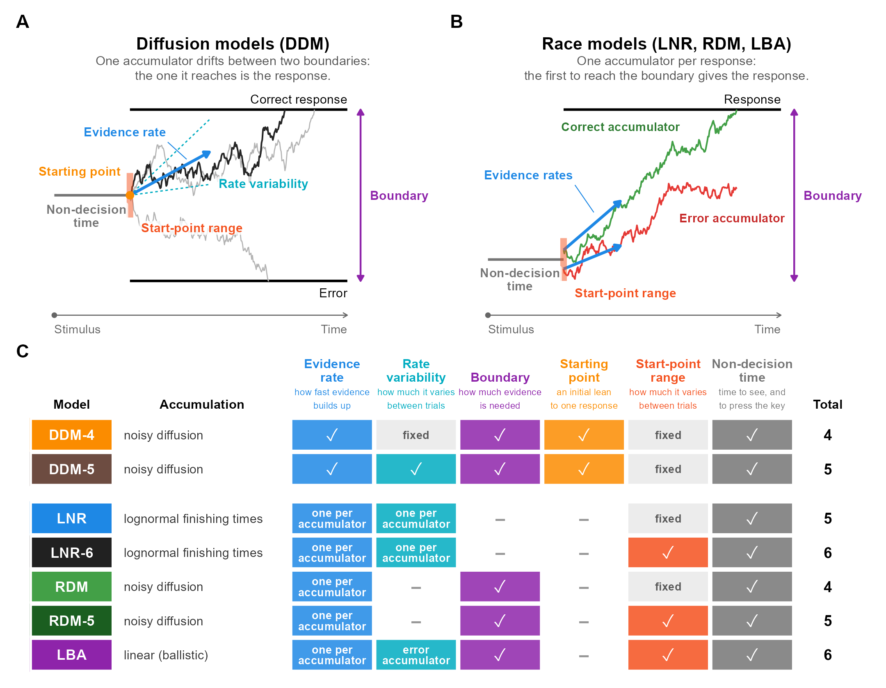
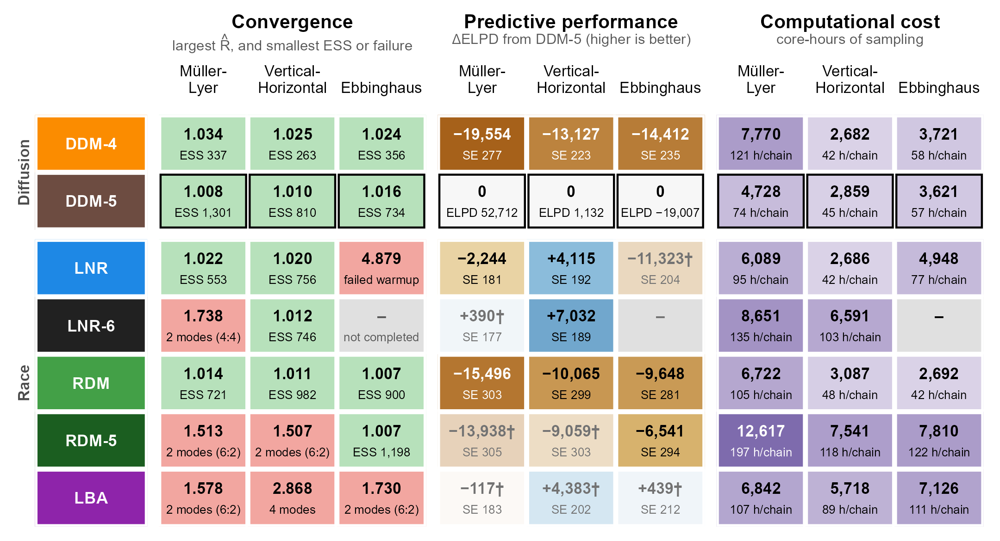
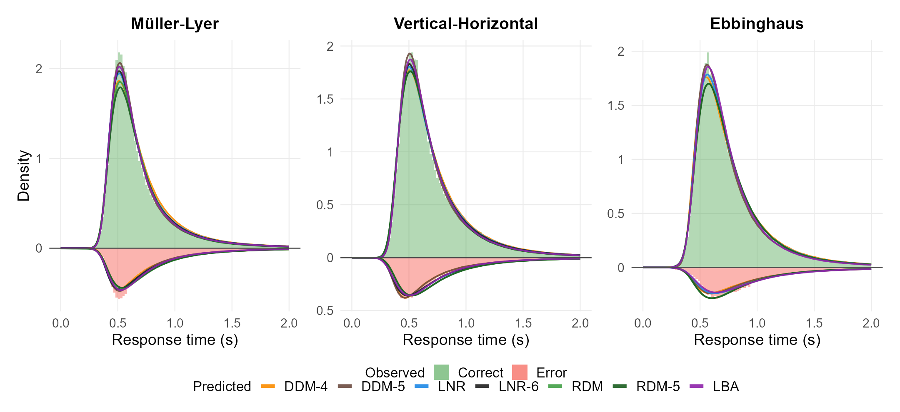
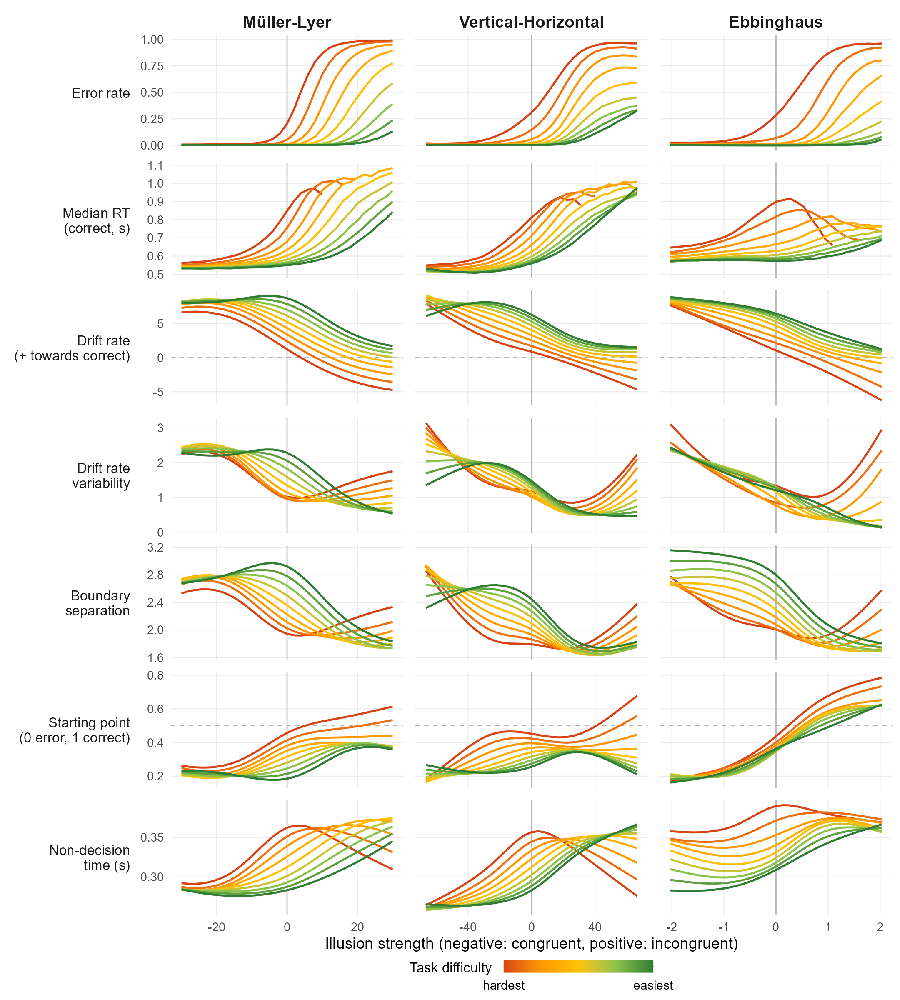

<!--
SCOPE AND FRAMING (notes to keep in mind for the write-up; not rendered)

What this is. A follow-up to the Illusion Game work. The data pool six earlier
Illusion Game studies (see analysis/0_preprocessing.qmd): about 2,200
participants and 320k trials per illusion, for three illusions (Müller-Lyer,
Vertical-Horizontal, Ebbinghaus). The question is how best to model the
paradigm: we compare evidence accumulation models, and the later goal is the
reliability of individual-level parameters, and perhaps their correlates.

The paper has two sides, and the framing has to hold both and articulate them as clearly and appealingly for both types of audiences.

1. About illusions
   - How illusion sensitivity works: which model parameters does illusion
     strength act on?
   - Is the effect of illusion strength dissociated from that of task
     difficulty (the size of the real perceptual difference)? Ideally they act
     on different parameters. If they don't, is their interaction additive, so
     that the two can still be separated and quantified statistically?
   - Do individual-level indices of sensitivity to the three illusions
     correlate, and for which parameters? This ties in with the general factor
     of illusion sensitivity from the earlier Illusion Game papers
     (Makowski et al., 2023).
   - To our knowledge, this level of analysis has never been applied to
     illusions, let alone with this statistical power.

2. Methodological, beyond illusions
   - Illusions as a perceptual interference task, perhaps akin to conflict
     tasks: an incongruent illusion works against the real difference the way
     an incongruent flanker or Stroop word does. Worth connecting to the
     conflict-task modelling literature (e.g., the Diffusion Model for Conflict
     tasks, Ulrich et al., 2015; the shrinking spotlight model, White et al.,
     2011).
   - Fitting these models is a feat in itself: some would take about half a
     year on a single core. Report the compute (CPU hours per model, from
     analysis/server/node_history.md) and what made it tractable (within-chain
     parallelism on a cluster, the cogmod package).
   - To our knowledge, LNR, LNR-6, LBA, DDM-4, DDM-5 and RDM have never been
     compared directly on the same data. (The registry also has RDM-5, and
     DDM-7, which is only viable on a subsample.)
   - The analysis itself is new. Every parameter of every model gets the same
     flexible effect of difficulty x illusion strength (a GAM tensor smooth,
     t2()), instead of each manipulation being assigned to one parameter in
     advance. Showing where each model puts the effects, and how this differs
     between models, tells us about the differences and trade-offs of these
     models (parameter trade-offs and mimicry, selective influence). That
     matters to anyone choosing a model, whatever the task.

Joining the two sides. One way to bridge them: the answer to "which parameters
does an illusion act on?" depends on the model you fit, and that dependence is
the methodological finding. The illusion question gives the model comparison
its reason to exist, and the comparison qualifies the answer to the illusion
question. Which side leads also depends on the journal: illusions first for a
perception or individual-differences journal, the model comparison first (with
illusions as the test case) for a methods journal.

Status (2026-11-24): Study 1 (the model comparison) is closed
   - Decision (2026-11-24): most models are unstable across the three
     illusions, and DDM-5 has the best characteristics (it converges on all
     three, predicts best among the converged models on two of them, and has
     smooth parameter curves consistent across illusions). It is retained for
     Study 2. No further variant is fitted for Study 1 (no sigmabias ~ 1,
     simplified LBA, LNR reparametrisation or DDM-7 subsample).
   - Study 2: DDM-5 with linear effects of difficulty x strength within the
     linear-approximation region, then participant-level slopes on illusion
     strength, which the cross-illusion correlations (side 1, third point)
     need. The Study 1 models only have a participant intercept on each
     parameter, (1 | Participant).
   - Numbers in Study 1 are from the prediction files of
     analysis/2_modelcomparison.qmd (models/predictions/).
-->

# Introduction

## The Illusion Game Paradigm

<!-- TODO: figure with example stimuli for the three illusions, crossing task difficulty and illusion strength (see the mosaics in RealityBending/IllusionGame, v3/examples/). -->

Visual illusions have mostly been studied through participants' reports of their own perception: observers are asked to adjust one target until it appears to match another, to estimate a target's physical properties, or to say whether two identical targets look different [@grzeczkowski2018perception; @cretenoud2020individual]. These procedures measure how much an illusion distorts appearance, but they rely on metacognitive judgements that depend on each observer's decision criterion and on the exact wording of the task [@skottun2014subjective]. Moreover, most studies use a single illusion, or a handful, presented over a narrow range of stimulus values [@cretenoud2019factors], which limits both the reliability of individual measures and the generality of the findings [@makowski2023novel].

The Illusion Game paradigm [@makowski2023novel] takes the opposite approach: instead of asking participants how strong an illusion looks, it measures what the illusion does to their performance in an objective perceptual task. It relies on a parametric framework for generating illusions, implemented in the open-source software *Pyllusion* [@makowski2021parametric], and built on the observation that many classic illusions consist of *targets* whose perception is biased by some feature of the display, typically their context. In the Müller-Lyer illusion, for instance, two horizontal lines (the targets) appear longer or shorter depending on the orientation of the fins at their ends (the context). Each illusion can thus be described by two parameters. The *task difficulty* is the objective difference between the targets (e.g., how much longer one line really is than the other): the smaller the difference, the harder the discrimination. The *illusion strength* is the magnitude of the biasing feature (e.g., the angle of the fins). Because they are specified separately, the two parameters can be varied continuously and independently of each other, so that any combination of an objective difference and an illusion strength can be generated.

The sign of the illusion strength sets the direction of the bias relative to the correct answer. When it is positive, the illusion is *incongruent*: it makes the objectively smaller target look bigger, working against the real difference and making the task harder. When it is negative, the illusion is *congruent*: it exaggerates the real difference and makes the task easier. A strength of zero corresponds to a neutral context. Illusion strength is thus a signed and graded variable, whereas task difficulty only sets how large the real difference is.

On each trial, after a fixation cross shown for a variable interval, participants see one stimulus and indicate which of the two targets is bigger or longer by pressing one of two arrow keys (e.g., the upper or the lower line for the Müller-Lyer illusion). They are instructed to respond "as fast as possible without making errors", a double constraint meant to limit individual differences in speed-accuracy trade-off [@makowski2023novel]. For each illusion, the stimuli combine a range of task difficulty levels with a range of illusion strengths spanning both congruent and incongruent effects, and are presented in random order within an illusion-specific block. Each trial therefore yields a choice (correct or error) and a response time (RT), and the effect of an illusion is measured by how much it impairs (when incongruent) or helps (when congruent) performance, beyond the objective difficulty of the discrimination.

The present work focuses on three illusions, common to all the datasets analysed here. In the *Müller-Lyer* illusion, participants indicate which of two horizontal red lines, one above the other, is longer; the illusion strength is the angle of the black fins at the ends of the lines, which make a line look longer or shorter. In the *Ebbinghaus* illusion, participants indicate which of two red circles, side by side, is bigger; each is surrounded by black circles, and a target surrounded by large circles looks smaller than one surrounded by small circles, so that the illusion strength is the relative size of the surrounding circles. In the *Vertical-Horizontal* illusion, participants indicate which of two red lines, side by side, is longer regardless of their orientation; one of the lines is rotated towards the vertical, and since vertical lines look longer than horizontal lines of the same length, the angle of rotation sets the illusion strength. These three illusions were among those most strongly related to the general factor of illusion sensitivity reported by @makowski2023novel.

In its first study, which covered ten illusions, the paradigm showed that illusion strength, task difficulty and their interaction affected performance for every illusion [@makowski2023novel]. Stronger illusions increased the error rate, as well as the mean and spread of RTs, but only up to a point, beyond which participants became faster again, as if a strong enough illusion made it easier to give the wrong answer. Participant-level sensitivities to the different illusions shared a substantial part of their variance, providing evidence for a general factor of illusion sensitivity (Factor *i*), which was related to personality traits. The paradigm has since been used in several further studies, whose data are pooled here. However, errors and RTs were modelled separately, and the participant-level scores were derived from error rates alone, which can be biased by each participant's speed-accuracy criterion. Analysing the two jointly, for instance with drift diffusion models, was identified as a necessary next step [@makowski2023novel].

Seen from decision-making research, the Illusion Game is a speeded two-alternative forced-choice task with two crossed manipulations. Task difficulty is a manipulation of stimulus discriminability, which evidence accumulation models usually expect to affect the rate at which evidence accumulates [@ratcliff2008diffusion]. Illusion strength adds a graded contextual influence that either supports or opposes the correct response. This resembles the congruency manipulation of conflict tasks such as the Stroop or flanker tasks, except that it varies continuously rather than taking two values. That the two manipulations are orthogonal by design does not imply that they affect separate cognitive processes: whether their effects can be told apart, and which components of the decision process each of them acts on, is an empirical question, and one that the present study addresses.

## The Present Studies

The present work pools the data of seven studies that used the Illusion Game, about 2,200 participants and over 300,000 trials for each of three illusions, and models errors and RTs jointly with evidence accumulation models. Study 1 compares seven such models, from the diffusion and race families. Rather than assigning each manipulation to one parameter in advance, every parameter of every model is free to vary with task difficulty and illusion strength. Study 2 builds on the model retained in Study 1 and replaces these flexible effects with linear ones, over the range of stimuli where they are close to linear.

<!-- TODO: Study 2's aims, once set (interpretable effects of the two manipulations; participant-level sensitivity to the illusion, its reliability and its correlations across illusions). -->

# Study 1: Comparing Evidence Accumulation Models

Evidence accumulation models describe a decision as the gradual build-up of noisy evidence up to a threshold, and account for the choice and its RT with the same few parameters [@ratcliff2008diffusion]. Many such models exist, and it is not known in advance which of them describes a new task best, nor whether its parameters can be estimated reliably. Study 1 compares seven of them on the three illusions, with three questions: which models can be estimated on these data, which predict them best, and which of their parameters task difficulty and illusion strength act on.

<!-- Figures and tables of Study 1 are image files made by analysis/2_modelcomparison.qmd ("Figures for the Paper") and saved to paper/figures/. Nothing is computed here: to update them, re-render that script. The tables are figures too, for the coloured cells and so that every output format lays them out the same way. -->

## Methods

### Data

The data come from seven studies that used the Illusion Game with the Müller-Lyer, Vertical-Horizontal and Ebbinghaus illusions, with 2,220 participants in total (details and code in `analysis/0_preprocessing.qmd`). We removed trials with RTs of 0 or of 6 s and longer. We also removed blocks in which a third or more of the congruent trials were errors (276 blocks, 2.07% of the trials). On these trials the illusion points to the correct answer and engaged participants are near-perfect, so that many errors are the signature of guessing or of reversed responding. We did not exclude on the overall error rate, which rises with sensitivity to the illusion as well as with invalid responding, nor on mean RT. The final data comprised 324,580 trials from 2,217 participants for the Müller-Lyer illusion, 321,113 trials from 2,202 participants for the Vertical-Horizontal illusion, and 316,487 trials from 2,181 participants for the Ebbinghaus illusion, a median of 160 trials per participant and illusion. The error rates were 23.8%, 20.3% and 17.3%, and the median RTs 607, 615 and 690 ms.

<!-- TODO: table of the seven datasets (N per study: Validation 256, EEG 100, Reliability 500, International 44, Suggestibility 778, Phenomenological Control 499, Self-Association 43), with each study's procedure (blocks, trials per illusion, ranges of difficulty and strength). As a figure made in analysis/0_preprocessing.qmd, like the other tables. -->

### Models

All the models compared here share one idea (@fig-study1-models). After the stimulus appears, noisy evidence accumulates over time until it reaches a boundary. The response is given at that moment, so that the choice and its RT come from the same process. The rest of the RT, spent encoding the stimulus and executing the key press, is the non-decision time. The parameters of these models stand for separate components of the decision: how fast evidence accumulates (the evidence rate, or drift rate), how much of it a response requires (the boundary), whether one response is favoured before any evidence comes in (the starting point), and how much these vary from one trial to the next. The models differ in the number of accumulators, in how evidence accumulates, and in which of these components they include.

{#fig-study1-models apa-twocolumn="true" apa-note="A and B: schematics of one trial. After the non-decision time, evidence accumulates until it reaches a boundary, which gives the response and the response time. The grey lines in A are two other trials, one of them ending in an error. C: the parameters of each model. A coloured cell is a parameter that is estimated and free to vary with task difficulty and illusion strength, a cell marked as fixed one that is set to a constant, and a dash a component that the model does not have. Race models have one evidence rate per accumulator. In the LNR, the rate and its variability are the location and the scale of the lognormal finishing times, from which the boundary cannot be told apart. In the LBA, the rate variability of the correct accumulator is fixed, which sets the scale of the model. Total: the number of estimated parameters, after which DDM-4, DDM-5, LNR-6 and RDM-5 are named."}

Two of the models were drift diffusion models [DDM, @ratcliff1978theory], in which a single accumulator drifts between two boundaries, one for the correct response and one for the error. DDM-4 has four parameters: the drift rate, the boundary separation, the starting point (as a proportion of the boundary separation) and the non-decision time. DDM-5 adds the variability of the drift rate from trial to trial [@ratcliff2002estimating]. The DDM has two further variabilities, of the starting point and of the non-decision time, which were fixed at zero. Estimating them takes the likelihood from its closed form to numerical integration, which multiplied the cost of each evaluation by 18 to 55, beyond what this amount of data allows.

The five others were race models, with one accumulator per response. The first accumulator to reach its boundary gives the response and the RT. These models differ in how an accumulator rises. In the racing diffusion model [RDM, @tillman2020sequential], each accumulator is a noisy diffusion process with its own drift rate, towards a boundary shared by the two. In the linear ballistic accumulator [LBA, @brown2008simplest], each rises in a straight line to a shared boundary, at a rate drawn on each trial from a normal distribution, from a starting point drawn uniformly between zero and a maximum, the start-point range. The SD of the rate of the correct accumulator was fixed at 1, which makes the LBA identifiable. The lognormal race [LNR, @rouder2015lognormal] does not describe the accumulation itself: the finishing time of each accumulator follows a lognormal distribution with its own location and scale. LNR and RDM start both accumulators at the same point on every trial, and LNR-6 and RDM-5 add to them a start-point range like that of the LBA. The seven models thus cover both architectures and, within each, a simpler and a more complete version of the same model (DDM-4 and DDM-5, LNR and LNR-6, RDM and RDM-5). Every model has a non-decision time.

### Effects of the Stimulus

It is common to assign each experimental manipulation to one parameter in advance, for instance stimulus discriminability to the drift rate. We made no such assumption. Every estimated parameter of every model (@fig-study1-models, panel C) was given the same flexible dependence on the stimulus: a smooth surface over task difficulty and illusion strength, estimated from the data, plus a random intercept per participant. Which parameters the two manipulations act on, and in what shape, is therefore a result for each model, not an assumption. The surface was a tensor-product smooth [`t2()`, with cubic regression spline bases of five knots on each dimension, @wood2017generalized]. Task difficulty was the absolute objective difference between the targets, and illusion strength its signed strength (positive when incongruent). Both were rescaled to the range from −1 to 1 within each illusion, keeping 0 as no illusion.

Every model was also a mixture with an outlier process, to absorb contaminant responses, with a population intercept and a random intercept per participant for its proportion. Errors were coded as the upper boundary in the DDM and as the second accumulator in the race models. The models thus had between four (DDM-4, RDM) and six (LNR-6, LBA) smoothed parameters, and over 11,000 parameters each, most of them participant intercepts. The priors were the family-specific defaults of the *cogmod* package [@makowski2026cogmod], with $\mathcal{N}(0, 2)$ on the coefficients it leaves flat. The full list, and where each posterior falls within its prior, is in the supplementary materials (`analysis/1_models.qmd`).

### Estimation

Each model was fitted separately to each illusion, which makes 21 fits. They were fitted with *brms* 2.21.0 [@burkner2017brms] and *Stan* [@carpenter2017stan] through *cmdstanr*, using the likelihoods of *cogmod* 0.3.5 [@makowski2026cogmod]. Each was sampled with eight chains of 1,500 warmup and 1,000 sampling iterations (8,000 posterior draws), run as four jobs of two chains on the University of Sussex high-performance computing cluster, each chain parallelised over eight threads.

<!-- TODO: the RDM fits of Vertical-Horizontal and Ebbinghaus in the numbers below are, as of 2026-11-24, from the stanli sampler (an alternative Stan backend), whose cmdstanr refits (jobs 11698240 and 11698242) were about to finish. Where both exist the two samplers agree (ELPD within 1, analysis/2_modelcomparison.qmd appendix). Once they are combined and predicted, re-render analysis/2_modelcomparison.qmd, which redraws Figure 3 (it prints a message while a stand-in is in it), and update the numbers of the text and of the cost paragraph from its table. -->

### Evaluation

The models were judged first on whether they could be estimated, and then on how well they predicted the data.

The models were estimated by Markov chain Monte Carlo, in which several independent chains explore the parameter space and should all end up sampling the same posterior distribution. When they do not, the fit has no single set of estimates to interpret. A fit was considered converged if its chains agreed. That meant a rank-normalised split $\hat{R}$ [@vehtari2021rank] of at most 1.05 on every population-level parameter (the smooth coefficients, their SDs and the participant-level SDs) and of at most 1.1 on the log posterior density, a bulk effective sample size (ESS) of at least 100 on every population-level parameter, fewer than 1% divergent transitions, and all eight chains in the same region of log posterior density. Participant intercepts were left out of the $\hat{R}$ criterion, as a few participants did not mix even in otherwise sound fits (see below).

Predictive performance was compared with the expected log pointwise predictive density (ELPD), which measures how well a model predicts trials that it was not fitted to. A higher ELPD is better, and flexibility that does not generalise to new trials does not raise it. It was estimated by Pareto-smoothed importance-sampling leave-one-out cross-validation [@vehtari2017practical; @vehtari2024pareto]. The models of an illusion are compared on the same trials, so the standard error of each difference was computed from the paired trial-wise values. The importance-sampling estimate was unreliable (Pareto $\hat{k} > 0.7$) on 0.09% to 0.57% of the trials, depending on the fit (0.15% to 0.25% for DDM-5).

## Results

@fig-study1-comparison gives the convergence, the predictive performance and the computational cost of the 21 fits.

{#fig-study1-comparison apa-twocolumn="true" apa-note="Convergence: the largest rank-normalised split $\hat{R}$ over the population-level parameters, on green if the fit converged and on red if it did not. Under it, the smallest bulk effective sample size (ESS) of these parameters or, for a fit that did not converge, how it failed: the number of separate modes its chains settled in, with how the eight chains divided between them, or a warmup that did not adapt. Predictive performance: the difference in expected log predictive density ($\Delta$ELPD) from DDM-5 on the same illusion, with its standard error, on blue where the model predicts better than DDM-5 and on brown where it predicts worse. The ELPD of DDM-5 is given in its own cells (SE = 838, 795 and 784). †: the fit did not converge, and its ELPD mixes separate posterior modes. Computational cost: core-hours of sampling over the eight chains, and the mean duration of a chain on eight threads. LNR-6 was not completed on the Ebbinghaus illusion. Black outline: the model retained for Study 2."}

### Convergence

Thirteen of the 21 fits converged. Only three models converged on all three illusions: DDM-4, DDM-5 and RDM. The four others failed on at least one illusion, and not on the same ones: LNR failed on the Ebbinghaus illusion only, LNR-6 on the Müller-Lyer and Ebbinghaus illusions, RDM-5 on the Müller-Lyer and Vertical-Horizontal illusions, and the LBA on all three.

The failures took two forms. In the first, the chains settled into separate modes, that is, into distinct sets of parameter values, each stable over the 1,000 sampling iterations and none left by any chain. It concerned the three models with a free start-point range, LNR-6, RDM-5 and the LBA, and only them: LNR and RDM, the same models without a start-point range, converged wherever LNR-6 and RDM-5 split into modes. In RDM-5, two of the eight chains sat about 1,650 (Müller-Lyer) and 500 (Vertical-Horizontal) units of log posterior density below the six others. In the LBA, two or three chains sat 1,400 to 1,800 units below the rest on every illusion. In LNR-6 on the Müller-Lyer illusion, the chains split four against four between two modes of almost the same density, less than half a posterior SD of log density apart. The modes disagreed on the start-point range together with other parameters. In RDM-5, they differed most in the effect of the stimulus on the start-point range and in its trade-off with the boundary, which varies with the same predictors. In LNR-6, they differed in the start-point range and in the location and scale of the correct accumulator. In the LBA, they also differed in the drift rate and variability of the error accumulator.

A free start-point range did not fail everywhere: LNR-6 converged on the Vertical-Horizontal illusion, and RDM-5 on the Ebbinghaus illusion. Nor was its dependence on the stimulus the whole problem. A variant of RDM-5 whose start-point range did not depend on the stimulus (a population intercept and participant intercepts only) still split into two modes on the Vertical-Horizontal illusion.

The second form was a failure of adaptation, in the LNR on the Ebbinghaus illusion. During warmup, the sampler tunes the size of its steps to the posterior. Here the step size shrank to between $5 \times 10^{-5}$ and $8 \times 10^{-4}$, one to two orders of magnitude below that of the same model on the other illusions, and the chains never reached a common distribution (population $\hat{R}$ = 4.88, with one chain far from all the others). This happened with 1,000 and with 1,500 warmup iterations, and across three versions of *cogmod*. LNR-6 showed the same failure on that illusion in the one job of the four that finished, and was not completed.

The converged fits had a population $\hat{R}$ of at most 1.034, a minimum bulk ESS of 263 to 1,301, and at most 0.29% of divergent transitions. DDM-5 was the best-behaved: $\hat{R} \leq 1.016$ and a bulk ESS of at least 734 on every illusion, with at most 0.20% of divergent transitions.

<!-- TODO: report the participants whose own parameters still do not mix after the longer refits, even in the models that converge (DDM-4, DDM-5, LNR). No one is excluded for this, as no a priori rule picks them out. They share a profile: fast, very consistent RTs, more errors than usual, and errors no slower than correct responses. The models have two equally good explanations for them, a later non-decision time or a lower one with a different boundary or outlier rate, and cannot choose between the two. List and plots in analysis/2_modelcomparison.qmd (Convergence). Evidence in analysis/server/AGENT.md 4.10 A. -->

<!-- Note (2026-11-24): the list of participants who do not mix (analysis/server/poorly_mixing_participants.csv) comes from the fits before the 2026-10-13 refit. Re-run analysis/server/mixing_participants.R on the combined fits of Study 1 before reporting it. -->

### Predictive Performance

All the models reproduced the overall distributions of correct and error RTs closely (@fig-study1-ppc), so that they differed mostly in how well they captured the effects of the conditions.

{#fig-study1-ppc apa-twocolumn="true" apa-note="Histograms: the observed response times of all trials, with correct responses upwards and errors downwards. Lines: the posterior predictive distribution of each model. The distributions of correct responses and of errors are each scaled by their share of the trials, so that the two areas sum to 1. The fits that did not converge are included."}

Among the models that converged on a given illusion, DDM-5 predicted best on the Müller-Lyer illusion, ahead of LNR ($\Delta$ELPD = 2,244, SE = 181), and on the Ebbinghaus illusion, ahead of RDM-5 ($\Delta$ELPD = 6,541, SE = 294). On the Vertical-Horizontal illusion, however, the two lognormal race models predicted better than DDM-5 (LNR-6: $\Delta$ELPD = 7,032, SE = 189; LNR: $\Delta$ELPD = 4,115, SE = 192). The two other models that converged everywhere, DDM-4 and RDM, ranked last and second to last among the converged models on every illusion. Adding drift variability to the DDM improved its ELPD by 13,127 to 19,554, the largest difference between two nested models in the comparison.

Three fits that did not converge had a higher ELPD than DDM-5: LNR-6 on the Müller-Lyer illusion ($\Delta$ELPD = 390, SE = 177), and the LBA on the Vertical-Horizontal ($\Delta$ELPD = 4,383, SE = 202) and Ebbinghaus illusions ($\Delta$ELPD = 439, SE = 212). Their ELPD, however, is that of a mixture of separate posterior modes, and does not belong to any one set of parameter values.

### Effects of the Conditions on the Parameters

@fig-study1-ddm5 shows what DDM-5 predicts for each stimulus, and how its five parameters vary with task difficulty and illusion strength.

{#fig-study1-ddm5 apa-twocolumn="true" apa-note="Each line is one of nine levels of task difficulty, from the smallest objective difference between the targets (hardest, red) to the largest (easiest, green). Illusion strength is in the units of each illusion: negative when congruent, positive when incongruent. The first two rows are the error rate and the median response time of correct responses that the model predicts (not drawn where the error rate exceeds 90%), and the others its parameters. The drift rate is positive when towards the correct response (dashed line: no drift). The starting point is a proportion of the boundary separation, from 0 at the error boundary to 1 at the correct boundary (dashed line: half-way). For the Müller-Lyer illusion, the curves are drawn over strengths of −30 to 30, out of a range of −49 to 49."}

<!-- In this figure and in the text below, two parameters of the DDM are turned around from how the fits store them, for the reader. The fits code an error as the upper boundary, so their drift is negative when towards the correct response, and their bias is the distance of the starting point from the correct boundary (0.8 = near the error boundary). The figure plots minus the drift and 1 minus the bias. analysis/2_modelcomparison.qmd keeps the fits' own coding everywhere but in the paper's figure (plot_retained()). -->

The parameters varied with the conditions in the same way on the three illusions. As the illusion went from congruent to incongruent, the drift rate went from strongly towards the correct response to weakly towards it, and, for the hardest discriminations under the strongest illusions, towards the error. The boundary separation narrowed, from about 2.5 to 3.2 for congruent illusions to about 1.7 for strongly incongruent ones. The drift variability decreased, from about 2.5 to between 0.5 and 1. The starting point, close to the error boundary on congruent trials (about 0.2 of the way from the error boundary to the correct one), moved towards the correct boundary, the more so the harder the discrimination. The non-decision time lengthened, by up to about 90 ms (from about 0.28 to 0.37 s).

In every parameter, a larger objective difference between the targets mostly shifted the curve towards stronger illusions, delaying the effect of the illusion, without changing its shape. Task difficulty and illusion strength thus acted on the same parameters, not on separate ones. Their effects were close to linear over a central range of stimuli, and became non-monotonic only at the extremes, for the hardest discriminations under the strongest incongruent illusions, where the error rate approaches its ceiling.

<!-- TODO: interpret the starting point, which sits near the error boundary on congruent trials and moves towards the correct one as the illusion becomes incongruent, against the strong drift towards the correct response (see the note on bias in the General Discussion). -->

Which parameters the conditions acted on depended on the model (the curves of every model are in the supplementary materials, `analysis/2_modelcomparison.qmd`). DDM-4 and DDM-5 even disagreed on the direction of the effect on the starting point: as illusion strength increased, the starting point of DDM-4 moved towards the error boundary (from about 0.6 to 0.35 on the Müller-Lyer illusion, on the scale of @fig-study1-ddm5), while that of DDM-5 moved towards the correct boundary. The boundary separation of DDM-4 hardly changed (between 1.56 and 1.72), whereas that of DDM-5 narrowed by about a third. The non-decision time varied by about 90 ms in DDM-5, against about 30 ms in DDM-4 and 20 ms in RDM. In the race models, the illusion acted mostly on the two accumulators in opposite directions, slowing the correct one and speeding up the error one.

<!-- TODO: a figure with the parameters of every model on one illusion (analysis/2_modelcomparison.qmd, "Parameter Curves"), in the paper or as a supplementary figure, for the paragraph above. -->

### Computational Cost

The 20 completed fits took about 114,500 core-hours of sampling, about 13 years on a single core, not counting the repeated, failed and test runs (@fig-study1-comparison). Depending on the model and the illusion, a chain took 42 to 197 h on average, on eight threads. DDM-5 was among the cheapest models (2,859 to 4,728 core-hours per illusion), and RDM-5 the most expensive (7,541 to 12,617). <!-- The single-core figure assumes that within-chain threading scales linearly, close to what was measured (analysis/server/AGENT.md 4.4.1). Numbers from the table under the comparison figure in analysis/2_modelcomparison.qmd ("Figures for the Paper"). --> <!-- TODO: say what made this tractable (within-chain parallelism on a cluster, the cogmod likelihoods). -->

## Discussion

Most of the models were unstable across the three illusions. Four of the seven failed to converge on at least one illusion, and which one varied from model to model, so that a model that behaved well on one illusion could not be trusted on another. Only DDM-4, DDM-5 and RDM converged on all three. Of these, DDM-5 predicted the data far better than the other two on every illusion, and better than every converged model on two of the three. Its parameters also varied with the conditions in the same way on the three illusions, smoothly, and non-monotonically only at the extremes of the stimulus space. We therefore retained DDM-5 for Study 2. Its main weakness is the Vertical-Horizontal illusion, on which both lognormal race models predicted better.

<!-- TODO: why LNR and LNR-6 predict better on Vertical-Horizontal only. -->

The failures are informative too. With every parameter free to vary with the conditions, the start-point range of the race models was not identified on these data: the chains split into separate modes in all three models that estimated it, each on at least one illusion, and only models that fixed it converged on all three illusions (see the General Discussion). A model with a better ELPD is therefore not necessarily a model whose parameters can be interpreted: three of the fits that predicted better than DDM-5 had no single set of estimates.

The comparison also shows that the answer to the question of which parameters an illusion acts on depends on the model that is fitted. Two closely related models, DDM-4 and DDM-5, disagreed even on the direction of an effect.

In DDM-5, task difficulty and illusion strength did not act on separate parameters, but on the same ones, and over most of the stimulus space a larger objective difference mostly offset the effect of the illusion. Their effects were also close to linear over a central range of stimuli. This suggests that, within that range, linear effects of the two manipulations and of their interaction could replace the smooths, giving each parameter a handful of interpretable coefficients instead of a surface. Study 2 tests this.

# Study 2: Linear-Approximation Models

<!-- TODO (planned 2026-11-24): DDM-5 with linear effects (~ Task_Difficulty * Illusion_Strength) instead of the t2() smooths, fitted within the linear-approximation region, where the DDM-5 smooths of Study 1 are close to bilinear. Müller-Lyer: difficulty 0.1-0.4 x strength -30 to 30 (drawn by eye). Vertical-Horizontal and Ebbinghaus: proposed but not set (analysis/2_modelcomparison.qmd, `linear_regions`). Then participant-level slopes on illusion strength, for the reliability of individual sensitivity and its correlations across illusions. -->

# General Discussion

<!-- TODO: discuss why the start-point range should not vary with the stimulus, and so why sigmabias ends up as 1 + (1 | Participant) (or ~ 1) rather than smoothed like the other parameters. (1) Theory, which motivates the choice but does not settle it. The start point is drawn before the stimulus is processed, and trials are randomly interleaved, so a participant cannot set the start-point range from a trial's strength or difficulty. The DDM's bias does vary with the predictors, and the same argument would apply to it, but its boundaries are correct vs. error (accuracy coding). A true pre-stimulus preference would therefore average 0.5, and a stimulus effect on bias reads as early, stimulus-driven processing that a fixed-drift DDM can only express as a shifted start. The obvious candidate is a fast automatic pull of the illusion, as in conflict-task models. The race models' start-point range is not the counterpart of that bias: it is a symmetric range shared by both accumulators, with no direction, and their directional early pull is carried by the two drifts, which vary with the conditions. Its DDM counterpart is start-point variability, which DDM-4 and DDM-5 also fix at 0. So an effect on bias does not predict one on the range, and theory gives no reason to expect one, though it cannot rule it out. (2) Identifiability, the decisive argument: in race models the response depends on the distance from start point to boundary, and the boundary already varies with the conditions. A condition effect on the start-point range is therefore nearly interchangeable with a condition effect on the boundary, and that trade-off is what separates the modes of the models that smooth sigmabias (Results). Linear terms would shrink the trade-off but not remove it, and a single slope on the signed illusion strength would also force the two sides of the illusion to mirror each other. Evidence in analysis/server/AGENT.md 4.10 B. -->

# References

::: {#refs}
:::
